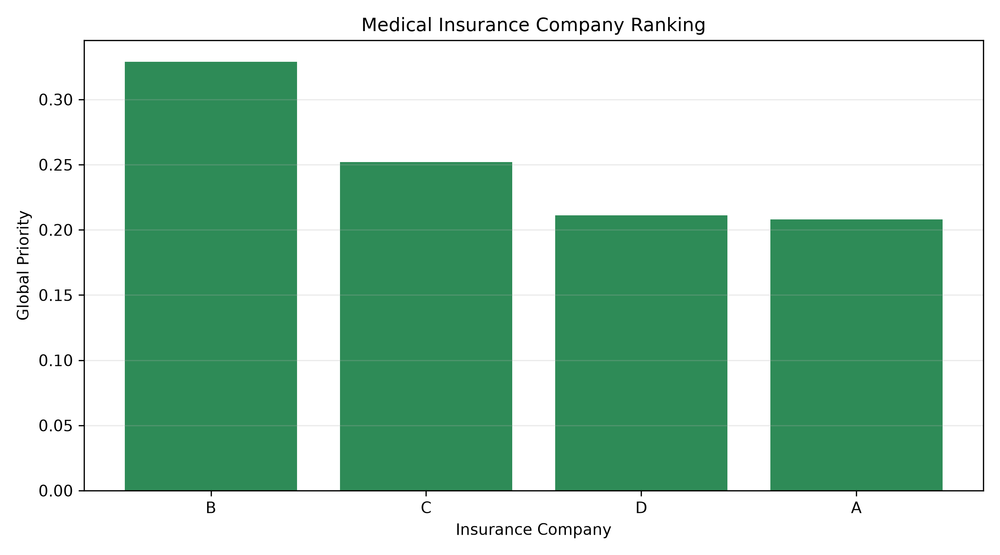
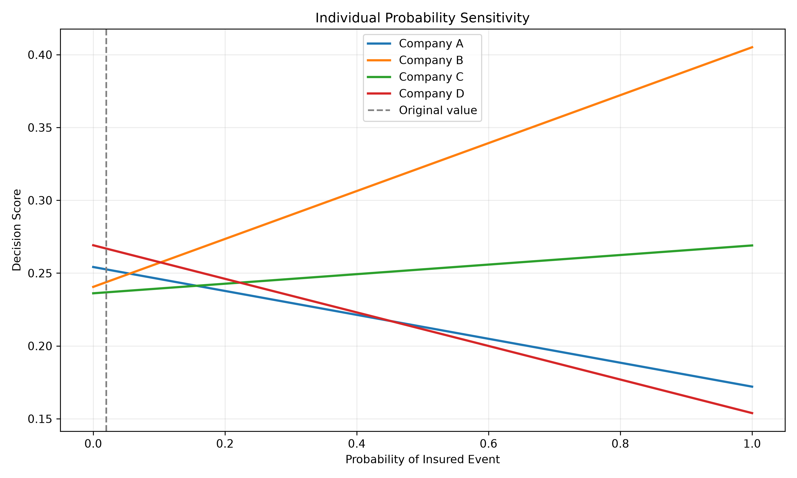

# MediChoice — Medical Insurance Decision Support

A research-oriented Python decision-support prototype for selecting among four simulated medical insurance companies using multi-criteria decision making (MCDM).



## Features

- Analytic Hierarchy Process (AHP) with geometric-mean priorities and consistency validation.
- Expected utility for decisions under risk and Wald's criterion under unknown probabilities.
- Group decision making with patients and healthcare experts.
- Linear and nonlinear maximin aggregation.
- Sensitivity analysis of event probability and insurance premium weight.
- Imprecise Dirichlet Model (IDM), epsilon-contamination and robust expected utility.
- Interactive Streamlit dashboard and reproducible CSV tables and PNG figures.

## Results

| Decision rule | Winning alternative | Score |
|---|---|---:|
| Individual baseline AHP | B | 0.328939 |
| Individual expected utility (2% event probability) | D | 0.266826 |
| Individual Wald criterion | B | 0.240537 |
| Individual baseline maximin | C | 0.011776 |
| Group baseline AHP | B | 0.367610 |
| Group expected utility | B | 0.323313 |
| Group Wald criterion | B | 0.321555 |

All 17 comparison matrices satisfy the model’s configured consistency threshold (CR ≤ 20%); the highest CR is 2.66%. All 30 implemented tests passed in the reported Windows run. The individual expected-utility winner switches from D to B at approximately 10.2185% event probability. The baseline linear winner switches from B to D at a premium criterion weight of 47.7163%.



## Getting started

Tested with Python 3.13.5 on Windows. From the project root in Command Prompt:

```cmd
python -m venv .venv
.venv\Scripts\activate
python -m pip install -r requirements.txt
```

Regenerate the computational results in order:

```cmd
python main.py
python ranking.py
python risk_analysis.py
python group_analysis.py
python aggregation_analysis.py
python sensitivity_analysis.py
```

Run tests:

```cmd
python -m pytest tests -v
```

Launch the dashboard:

```cmd
python -m streamlit run app.py
```

Open http://localhost:8501 in your browser. The dashboard reads the generated result tables and the illustrative dataset in `data/`.

## Project structure

```text
medichoice-decision-support/
├── data/                    # Simulated company profiles
├── src/                     # Decision algorithms and comparison matrices
├── tests/                   # Automated numerical tests
├── results/
│   ├── figures/             # Generated charts
│   ├── matrices/            # Comparison matrices
│   └── tables/              # Computed results
├── main.py                  # Local AHP priorities
├── ranking.py               # Baseline ranking
├── risk_analysis.py         # Risk and uncertainty
├── group_analysis.py        # Group decision making
├── aggregation_analysis.py  # Linear vs nonlinear aggregation
├── sensitivity_analysis.py  # Sensitivity and IDM
├── app.py                   # Streamlit dashboard
└── requirements.txt
```

## Model assumptions and limitations

Originally developed as an academic project, MediChoice is a research prototype. The four companies, numerical profiles, pairwise judgments, stakeholder preferences and IDM observation counts are hypothetical. The baseline insured-event probability of 2% is a scenario assumption, not an empirical estimate. The 20% consistency threshold is specific to this model configuration, not a universal AHP standard. The comparison matrices are fixed in source code rather than generated from the illustrative CSV. This prototype is not a real insurance recommendation. The tests cover the implemented numerical cases, not every possible input or dashboard interaction.
